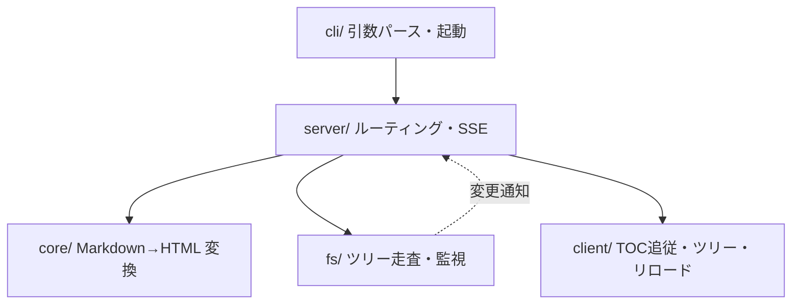

# md-viewer 基本設計書

## 1. 目的とスコープ

ローカルの Markdown ファイル/フォルダを、ブラウザで快適に**閲覧**するためのツール。

### スコープ内
- ローカルフォルダを起点としたファイルツリー閲覧
- Mermaid 図・数式 (KaTeX) のレンダリング
- 目次 (TOC) 生成とスクロール追従
- PDF / 静的 HTML 出力
- ファイル変更の自動反映（ライブリロード）

### スコープ外（明示的に作らない）
- Markdown の編集・保存機能
- 認証、マルチユーザー、クラウド同期
- 全文検索（M7 以降の候補として保留）

---

## 2. 方式選定

### 採用: CLI + ローカル HTTP サーバ + ブラウザ表示

```
$ md-viewer ./docs
  ✓ serving ./docs at http://127.0.0.1:5711
```

### 比較検討

| 方式 | 長所 | 短所 | 判定 |
|---|---|---|---|
| 純 Web アプリ | 配布不要、共有容易 | File System Access API が Safari 非対応。フォルダ走査・ファイル監視が実現困難 | ✗ 要件（ローカルフォルダ）を満たせない |
| **CLI + localhost** | Web 技術をそのまま使える。fs アクセス自由。配布は npm 一本 | ターミナル起動が必要 | ✓ **採用** |
| Tauri / Electron | ネイティブ体験、ファイル関連付け可能 | インストーラ署名・自動更新・クロスビルドのコストが機能価値を上回る | ✗ ビューワ規模には過剰 |

**採用理由**: 閲覧専用なのでファイル書き込み権限が不要 → サーバは read-only で完結し、権限設計・コンフリクト考慮が消える。CLI 起動は開発者向けツールとして許容範囲。

---

## 3. 技術スタック

| 領域 | 選定 | 理由 |
|---|---|---|
| ランタイム | Node.js >= 20 + TypeScript | ES Module / `node:` prefix / fetch 標準搭載 |
| CLI | `commander` | 枯れており依存が軽い |
| HTTP サーバ | `hono` | 軽量・型安全。Node/Bun 両対応で将来の移行余地 |
| Markdown パーサ | `markdown-it` | anchor / toc / katex 系プラグインが枯れている。remark より高速 |
| 数式 | `@vscode/markdown-it-katex` + KaTeX | **サーバ側で HTML 化**。クライアント JS 不要 |
| 図 | `mermaid` | **クライアント側で描画**（サーバ SVG 化は puppeteer 必須で重い） |
| コードハイライト | `shiki` | VS Code 同エンジン。サーバ側で HTML 化するため CSS テーマ管理が不要 |
| ファイル監視 | `chokidar` | macOS の FSEvents を含むクロスプラットフォーム対応 |
| フロントエンド | **素の TS + CSS**（フレームワークなし） | サーバが完成 HTML を返す。JS の役割は TOC 追従・ツリー開閉・リロードのみ |
| PDF 出力 | ブラウザの印刷機能 + `@media print` CSS | puppeteer を持ち込まずに要件充足 |

### 意図的に採用しないもの
- **React / Vite SPA**: 静的な文書表示に仮想 DOM は不要。初期表示が遅くなるだけ
- **WebSocket**: ライブリロードは一方向通知のみ → SSE で足りる
- **puppeteer**: PDF は印刷ダイアログに委譲。依存 200MB を回避

---

## 4. アーキテクチャ

### レイヤ構成



| ディレクトリ | 責務 | 副作用 |
|---|---|---|
| `src/cli/` | 引数解析、ポート決定、ブラウザ起動 | あり |
| `src/core/` | `render(markdown, opts) → { html, toc }` | **なし（純関数）** |
| `src/fs/` | ディレクトリ走査、パス解決、chokidar 監視 | あり |
| `src/server/` | HTTP ルーティング、HTML 組み立て、SSE 配信 | あり |
| `src/client/` | ブラウザ側の最小スクリプト | あり |

**設計原則**: 変換ロジック (`core/`) を副作用ゼロの純関数に閉じ込める。これにより Markdown → HTML の全機能が I/O なしで単体テスト可能になり、`export` コマンドとサーバが同一コードを共有できる。

### ディレクトリ構成案

```
md-viewer/
├── src/
│   ├── cli/index.ts          # エントリポイント
│   ├── core/
│   │   ├── renderer.ts       # markdown-it インスタンス構築
│   │   ├── frontmatter.ts    # YAML frontmatter の抽出
│   │   ├── links.ts          # 相対リンクの判定
│   │   ├── escape.ts         # HTML エスケープ
│   │   └── toc.ts            # 見出し抽出 → TOC ツリー
│   ├── fs/
│   │   ├── tree.ts           # 再帰走査 → FileNode[]
│   │   ├── resolve.ts        # パストラバーサル防御
│   │   └── watcher.ts        # chokidar
│   ├── view/
│   │   └── layout.ts         # シェル HTML・ツリー・目次の描画
│   ├── paths.ts              # パッケージ内アセットの場所
│   ├── server/
│   │   ├── app.ts            # hono ルーティング
│   │   ├── highlight.ts      # shiki ラッパ
│   │   └── broadcast.ts      # 変更イベントの配信
│   ├── export/
│   │   ├── site.ts           # 静的サイト出力
│   │   └── page.ts           # 自己完結 HTML の生成
│   └── client/
│       ├── main.ts           # エントリ
│       ├── toc.ts            # 目次のスクロール追従
│       ├── tree.ts           # ツリー開閉の記憶
│       ├── mermaid.ts        # 図の描画
│       └── reload.ts         # EventSource
├── styles/
│   ├── base.css              # 変数・レイアウト・ツリー・目次
│   ├── markdown.css          # GitHub 風
│   ├── code.css              # shiki / mermaid / KaTeX
│   └── print.css             # PDF 出力用
└── DESIGN.md
```

---

## 5. 主要データ型

```typescript
type FileNode =
  | { kind: 'file'; name: string; relPath: string }
  | { kind: 'dir'; name: string; relPath: string; children: FileNode[] };

type TocEntry = {
  readonly level: 1 | 2 | 3 | 4 | 5 | 6;
  readonly text: string;
  readonly slug: string;   // アンカー ID
  readonly children: readonly TocEntry[];
};

type RenderResult = {
  readonly html: string;
  readonly toc: readonly TocEntry[];
  readonly hasMermaid: boolean;  // client の mermaid を動的 import する判定
  readonly frontmatter: Readonly<Record<string, unknown>>;
};

type RenderError =
  | { type: 'not-found'; relPath: string }
  | { type: 'outside-root'; requested: string }
  | { type: 'not-markdown'; relPath: string };
```

エラーは例外を投げずに判別可能ユニオンで返し、呼び出し側で HTTP ステータスへマッピングする。

---

## 6. HTTP インタフェース

| メソッド | パス | 応答 | 備考 |
|---|---|---|---|
| GET | `/` | HTML | `README.md` があればそれを表示、なければツリー |
| GET | `/view/*` | HTML | Markdown をレンダリングして返す |
| GET | `/api/tree` | JSON | `FileNode[]` |
| GET | `/api/raw/*` | text/markdown | 生ソース表示用 |
| GET | `/assets/*` | binary | Markdown からの相対参照画像 |
| GET | `/__events` | text/event-stream | SSE（`{ type: 'change', relPath }`） |
| GET | `/__static/*` | JS/CSS | クライアントアセット |

`__` prefix は内部エンドポイントの目印。ユーザーの実ファイルと衝突しないよう予約する。

---

## 7. 画面設計

```
┌────────────────────────────────────────────────────────┐
│  md-viewer   ./docs                       [🌗] [印刷]  │
├──────────────┬──────────────────────────┬──────────────┤
│ FILE TREE    │                          │ ON THIS PAGE │
│              │   # 見出し               │              │
│ ▾ docs/      │                          │  見出し      │
│   ▾ guide/   │   本文テキスト...        │   ├ 節1      │
│     • intro  │                          │   └ 節2      │
│     • setup  │   ```mermaid             │  次の見出し  │
│   • README   │   （図がここに描画）     │              │
│              │   ```                    │  ← 現在位置  │
│  240px       │        max-width: 80ch   │      220px   │
└──────────────┴──────────────────────────┴──────────────┘
```

- **本文幅**: `max-width: 80ch` — 可読性の上限
- **レスポンシブ**: 1200px 未満で TOC を折りたたみ、900px 未満でツリーをドロワー化
- **テーマ**: `prefers-color-scheme` に追従 + 手動トグル（`localStorage` 永続化）
- **TOC 追従**: `IntersectionObserver` で現在の見出しをハイライト（スクロールイベント連打を避ける）

---

## 8. セキュリティ

閲覧専用ローカルツールだが、以下は必須。

| リスク | 対策 |
|---|---|
| 外部からのアクセス | `127.0.0.1` のみに bind（`0.0.0.0` にしない） |
| パストラバーサル (`../../etc/passwd`) | `path.resolve` 後にルートディレクトリの接頭辞一致を検証。シンボリックリンクは `realpath` 解決後に再検証 |
| Markdown 内の生 HTML による XSS | markdown-it の `html: false` を既定とし、`--allow-html` を指定した場合のみ許可（その場合もサニタイズを通す） |
| 巨大ファイルによるメモリ枯渇 | ファイルサイズ上限（既定 10MB）を超えたら生テキスト表示にフォールバック |
| DNS rebinding | `Host` ヘッダを `localhost` / `127.0.0.1` に限定して検証 |

---

## 9. PDF / HTML 出力

### PDF
`@media print` CSS でツリー・TOC・ヘッダを非表示化し、ブラウザの印刷ダイアログに委譲する。
- `page-break-inside: avoid` をコードブロック・表・図に適用
- リンクの URL を `a[href]::after` で脚注として展開（印刷時のみ）
- Mermaid は描画完了後に `window.print()` を呼ぶ（未描画のまま印刷されるのを防ぐ）

### 静的 HTML
```
$ md-viewer export ./docs -o ./out
```
- `core/` を再利用してサーバなしで全ファイルを変換
- ファイル間リンク（`./setup.md`）を `./setup.html` に書き換え、階層構造は出力先にそのまま写す
- アプリ CSS（約 7KB）は各ページに `<style>` でインライン化
- 共有アセットは `_assets/` に 1 部だけ置き、ページの深さに応じた相対パスで参照する
  - `_assets/mermaid.js`（3.5MB）— 全ページに埋め込むのは非現実的なため相対参照とする
  - `_assets/katex.css` + `_assets/fonts/*.woff2`（woff/ttf は複製しない）
- `file://` では ESM の `import` が使えないため、埋め込むスクリプトは classic script に限る
- 目次のスクロール追従は静的出力では省略する（リンクとしてのジャンプは動く）

出力構造:
```
out/
├── index.html          # README.md の複製（入口）
├── README.html
├── guide/intro.html
├── img/logo.svg        # 参照された画像を複製
└── _assets/
    ├── katex.css
    ├── mermaid.js
    └── fonts/*.woff2
```

---

## 10. マイルストーン

| # | 内容 | 完了条件 | 状態 |
|---|---|---|---|
| M1 | CLI + サーバ + 単一ファイル表示 | `md-viewer foo.md` でブラウザに表示される | ✅ 完了 |
| M2 | ファイルツリー + ルーティング | フォルダを指定してツリーから遷移できる | ✅ 完了 |
| M3 | Mermaid + KaTeX + ハイライト | 3 種すべてが正しく描画される | ✅ 完了 |
| M4 | TOC + スクロール追従 | 見出しジャンプと現在位置ハイライトが動く | ✅ 完了 |
| M5 | ライブリロード | ファイル保存で自動再描画される | ✅ 完了 |
| M6 | print CSS + `export` コマンド | PDF 出力と静的 HTML 出力が動く | ✅ 完了 |
| M7 | （保留）全文検索 | — | 未着手 |

M1〜M2 で「使える」状態、M4 までで「実用」、M6 で「完成」。

---

## 11. 決定事項と残る課題

### 決定済み

1. **既定ポート** — 5711 から順に +1 して空きを探す。`--port` を明示した場合はずらさずエラーにする（暗黙のポート変更で混乱させない）
2. **frontmatter** — 本文には出さない。`title` があれば `<h1>` として補い、`<title>` にも使う。ただし本文が `<h1>` で始まる場合は補わない
3. **`.md` 以外** — ツリーに載せるのは `.md` / `.markdown` のみ。画像などは `/assets/` で配信し、`export` 時は参照されたものだけ複製する
4. **mermaid の静的出力** — `_assets/mermaid.js` を 1 部置いて相対参照する（§9 参照）
5. **ツリーの開閉** — `localStorage` に記憶する。現在ファイルを含む階層はサーバ側で常に開く

### 残る課題

- **パッケージ配布形態** — `npm i -g` か `npx md-viewer` 前提か
- **M7: 全文検索** — 保留中
- **ツリー・目次のキャッシュ** — 現在はリクエストごとに走査している。大きなフォルダで問題が出たら、監視イベントを契機にした無効化を入れる
