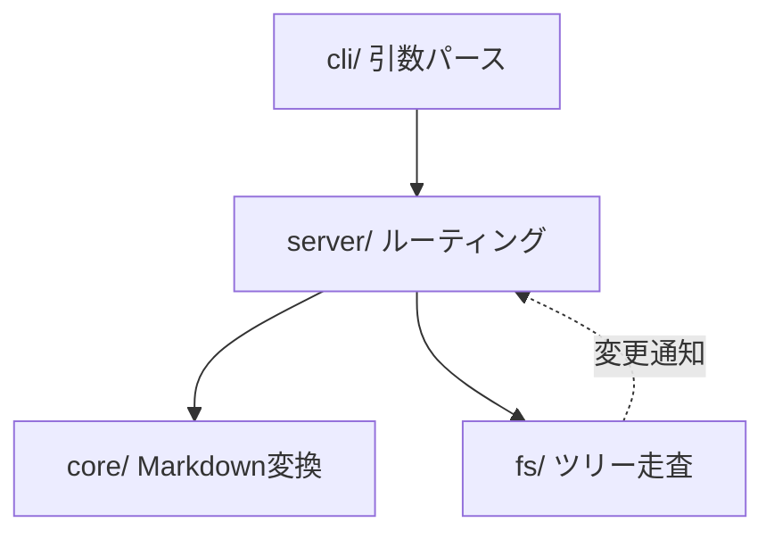
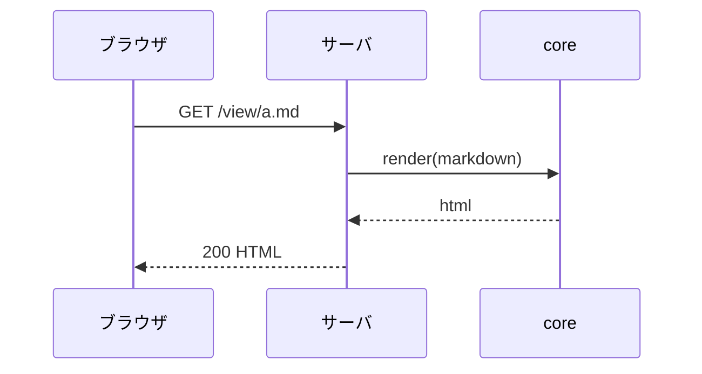

frontmatter の `title` が h1 として補われ、YAML 本体は表示されないでっしゅ。

## Mermaid 図





## 数式 (KaTeX)

インライン数式: 質量とエネルギーの関係は $E = mc^2$ でっしゅ。

ディスプレイ数式:

$$
\int_{0}^{1} x^2 \, dx = \frac{1}{3}
$$

$$
\sum_{i=1}^{n} i = \frac{n(n+1)}{2}
$$

## シンタックスハイライト (Shiki)

TypeScript:

```typescript
export const createRenderer = (options: RendererOptions = {}): Renderer => {
  const md = new MarkdownItFactory({ html: false, linkify: true });
  return (source) => ({ html: md.render(source) });
};
```

Python:

```python
def fib(n: int) -> int:
    return n if n < 2 else fib(n - 1) + fib(n - 2)
```

Bash:

```bash
$ md-viewer ./docs --port 5711
  ✓ serving README.md at http://127.0.0.1:5711
```

未対応の言語（既定描画にフォールバック）:

```brainfuck
++++++++[>++++[>++<-]<-]
```
